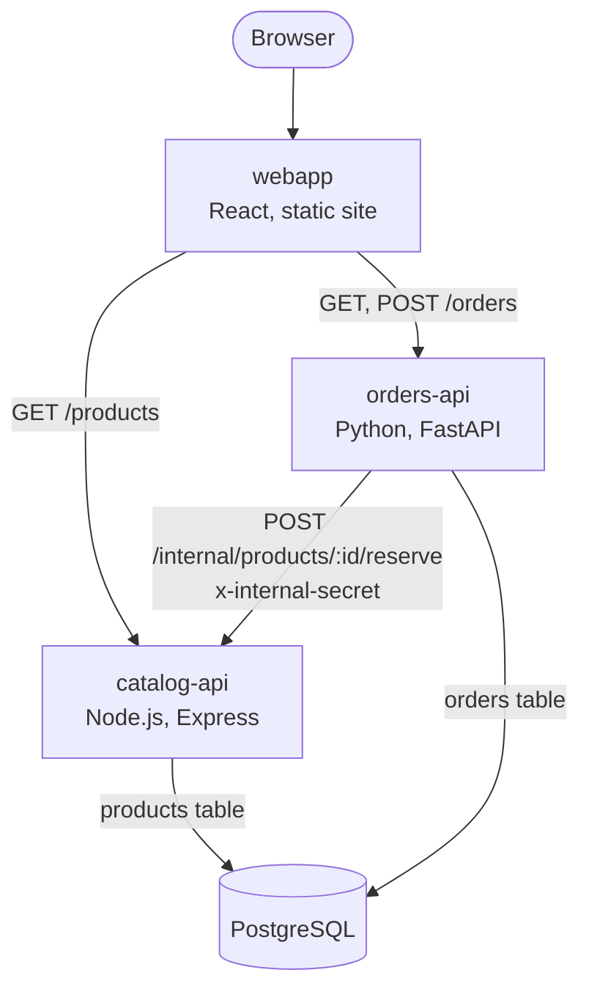

# Jaffel shop: a microservices app for coffeeshop orders

A tiny coffee shop orders split into three services and one database.



| Folder | What it is | 
|---|---|
| `webapp/` | React (Vite) shop front | 
| `catalog-api/` | Products and stock (Express); `GET /work?ms=500` burns CPU for load tests | 
| `orders-api/` | Orders (FastAPI); asks catalog-api to reserve stock | 

## How the services talk

- The browser calls both APIs directly, so both APIs allow the web app's
  address with CORS (`WEB_ORIGIN`, one or more comma-separated origins).
- `orders-api` calls `catalog-api` at `POST /internal/products/:id/reserve`.
  Internal routes require the `x-internal-secret` header, which must match
  `INTERNAL_SECRET` on both services. During a rotation catalog-api also
  accepts `INTERNAL_SECRET_PREVIOUS`, so the secret can change without
  downtime.
- Every request carries an `x-request-id`. It is passed from orders-api to
  catalog-api, returned in the response and printed in both logs as JSON with
  a `severity` field, so one order can be followed across services and
  filtered by level in the Logs tab.
- Both APIs use the same PostgreSQL database. Each service owns its own
  table (`products`, `orders`) and never reads the other's.

## Environment variables

| Variable | Service | Example |
|---|---|---|
| `VITE_CATALOG_API_URL` | webapp (build time) | `http://localhost:8080` |
| `VITE_ORDERS_API_URL` | webapp (build time) | `http://localhost:8000` |
| `DATABASE_URL` | catalog-api, orders-api | the database connection string |
| `INTERNAL_SECRET` | catalog-api, orders-api | a long random string, same on both |
| `INTERNAL_SECRET_PREVIOUS` | catalog-api (optional) | the old secret, only while rotating |
| `WEB_ORIGIN` | catalog-api, orders-api | one or more origins, comma-separated: `http://localhost:3000` |
| `CATALOG_API_URL` | orders-api | `http://localhost:8080` |
| `CATALOG_TIMEOUT_SECONDS` | orders-api (optional) | seconds to wait for catalog-api, default `5` |
| `DB_POOL_MAX` | catalog-api (optional) | database connections per instance, default `2`; keep `DB_POOL_MAX` x max instances under the database's connection limit |

For `catalog-api` (Node.js), end the Light Cloud connection string with
`?sslmode=require&uselibpqcompat=true`, otherwise the `pg` driver rejects
the database certificate.

## Run the application with Docker Compose

Docker Compose builds and tags the three application images, starts PostgreSQL
with a persistent named volume, and waits for the database and catalog API to
be healthy before starting dependent services.

```bash
docker compose up --build -d
docker compose ps
```

For local development, Compose uses `postgres` as the database password and a
development-only internal secret. Set `POSTGRES_PASSWORD` and `INTERNAL_SECRET`
in the environment or a root `.env` file to override them. The image tags are
`jaffelshop-webapp:latest`, `jaffelshop-catalog-api:latest`, and
`jaffelshop-orders-api:latest`.

Open the webapp at http://localhost:3000. The shop is at `/` and order history
is at `/orders`; the APIs remain available at ports 8080 (catalog) and 8000
(orders).

### Check the services

```bash
curl http://localhost:8080/health
curl http://localhost:8080/ready
curl http://localhost:8080/products
curl http://localhost:8000/health
curl http://localhost:8000/ready
curl http://localhost:8000/orders
```

Health endpoints should return JSON with `"status":"ok"`; readiness endpoints
should return `"status":"ready"`. The products endpoint returns the seed
catalog, and the orders endpoint lists recent orders.

To test the two pages, open the shop, place an order, and follow the “View
orders” link. Confirm the new order appears at `/orders`, refresh that page to
check direct-route handling, then use “Shop” to return to the products.

To create an order directly through the REST API, expect HTTP `201`:

```bash
curl -i -X POST http://localhost:8000/orders \
  -H 'Content-Type: application/json' \
  -d '{"product_id":1,"quantity":1}'
```

Then call `GET /orders` and `GET /products` again: the new order should appear
and product 1 stock should decrease by one.

To check insufficient-stock handling, request more units than product 1 has in
stock; expect HTTP `409`. To inspect service logs, run `docker compose logs -f`.
Stop the services with `docker compose down`; the named database volume remains
so data is retained for the next start.

## License

MIT
