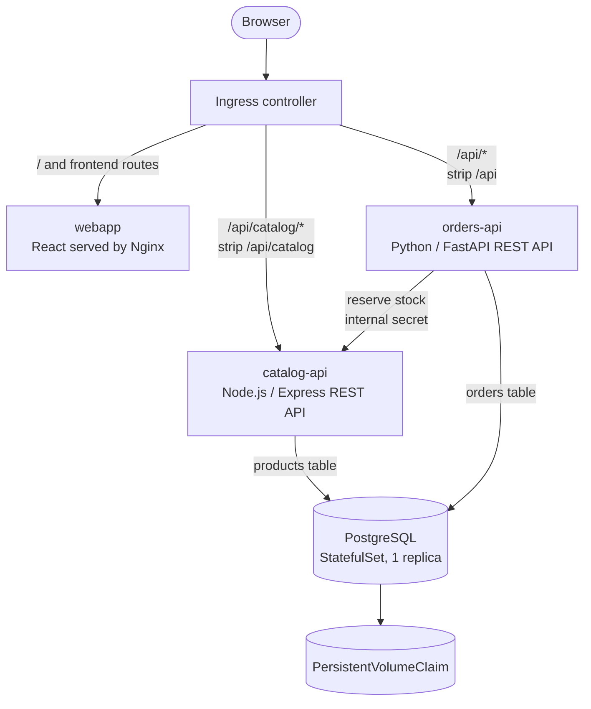

# Jaffel Shop on Kubernetes

These manifests deploy the Jaffel Shop storefront, two REST APIs, and a
PostgreSQL database to a Docker Desktop Kubernetes cluster. The application
images use the published `v1.0.0` Docker Hub tags.

## Software description

Jaffel Shop is a small coffee shop application. Customers can browse products,
prices, and stock, place an order, and view recent orders. The storefront does
not currently include an administrative restocking feature; stock is reduced
when an order is placed, and restocking is currently an operational database
update.

## Architecture



- **webapp** is a React/Vite frontend served as static files by Nginx. It calls
  the APIs using same-origin paths, so browser code does not need Kubernetes
  service DNS names.
- **catalog-api** owns product and stock operations. It serves the catalog and
  has an internal reservation endpoint used by `orders-api`.
- **orders-api** accepts orders, asks `catalog-api` to reserve stock, then saves
  the order.
- **PostgreSQL** stores the `products` and `orders` tables. Each API owns its
  table, but both currently use one PostgreSQL instance.
- **Ingress** sends `/` and frontend routes to the webapp. It strips
  `/api/catalog` before routing catalog requests and `/api` before routing
  order requests. The API and webapp Services remain internal `ClusterIP`
  Services.
- Each application runs in a separate Kubernetes Deployment. The APIs can be
  scaled independently. PostgreSQL is a single-replica StatefulSet with a PVC;
  it is intentionally not scaled.

This design uses service boundaries and REST APIs, containers, Kubernetes
Services for stable internal discovery, and declarative manifests. Readiness
and liveness probes let Kubernetes check whether application Pods can serve
requests and whether they should be restarted.

## Benefits and tradeoffs

Separate services give the catalog, order workflow, and presentation distinct
responsibilities. The catalog and order APIs use different implementation
stacks, and each can be scaled without changing the other API's replica count.
The Ingress provides one browser entry point and routes paths to the correct
backend.

The order workflow crosses a service boundary: stock is reserved before the
order record is written. If saving the order fails after the reservation
succeeds, stock may be reduced without a matching order. The current demo has no
compensation step. A production version could use an idempotent workflow with a
compensation action, or a saga/outbox approach.

Both APIs share one PostgreSQL instance. Separate tables clarify ownership,
but a database outage affects both APIs, and database capacity is shared. The
single PostgreSQL replica is also a point of failure. The PVC preserves data
across Pod and workload restarts while the claim and Docker Desktop storage are
retained; it is not a backup. Production use would need tested backups and
recovery, and durable storage beyond a local development cluster.

## Security

The database is available only inside the cluster. The catalog reservation
endpoint requires the shared internal secret, and the comparison is performed
in constant time. API inputs are validated and SQL values are parameterized.
The secret is supplied through a Kubernetes Secret; `secrets.yaml` is
intentionally git-ignored. Base64 is encoding, not encryption. Production
clusters should restrict Secret access with RBAC and configure encryption at
rest or use a secret manager.

The browser-facing order endpoint has no customer authentication, and this
local demo does not configure TLS. A public deployment should add authentication
and authorization, rate limiting, HTTPS, and a deliberate CORS policy. The
local PVC can also be lost if it is deleted or Docker Desktop's Kubernetes
storage is reset.

## Before applying

1. Ensure Docker Desktop Kubernetes is enabled and `kubectl` uses the
   `docker-desktop` context.
2. Ensure an NGINX Ingress Controller and the `nginx` IngressClass are installed.
   The Ingress manifest uses NGINX-specific rewrite annotations.
3. Copy `secrets.yaml.example` to `secrets.yaml`. Replace both password
   placeholders, using the same URL-safe password in `POSTGRES_PASSWORD` and
   `DATABASE_URL`, and replace `INTERNAL_SECRET` with a long random value.
   `secrets.yaml` is git-ignored; do not commit it.
4. The database PVC requests `1Gi` and uses the cluster's default StorageClass
   because `storageClassName` is omitted. `10Mi` is too small for a PostgreSQL
   data directory.

## Apply

From this directory:

```sh
kubectl apply -f namespace.yaml
kubectl apply -f secrets.yaml
kubectl apply -k .
kubectl -n jaffelshop get pods,pvc,services,ingress
```

The PVC keeps database files through Pod and workload restarts as long as the
PVC and Docker Desktop's Kubernetes storage are retained. Deleting the PVC or
resetting Docker Desktop's Kubernetes storage can delete the data.

For local access, check the Ingress address with:

```sh
kubectl -n jaffelshop get ingress
```

The URL depends on the NGINX controller setup. Do not apply the Ingress until
`kubectl get ingressclass` shows the `nginx` class.
